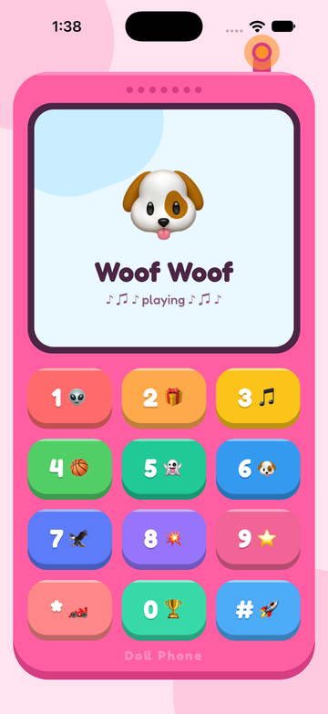

# Doll Phone

A toy phone for little kids. Every key on the keypad plays a fun sound and shows a
matching picture on the phone's screen, while the antenna light blinks along.

<p align="center">
  
</p>

## Features

- **12 sound keys:** big, candy-colored keys with a number and emoji. Each press
  plays its sound instantly, with a press-down animation and a light haptic tap.
- **Phone screen:** the key's emoji bounces and wiggles, with the sound's name and a
  "playing" indicator underneath.
- **Antenna light:** steady yellow while idle; blinks orange while a sound plays,
  switching to a new pattern (blink, ring-ring, pulse) on every press.
- **Kid-proof playback:** one sound at a time, pressing again restarts it, sound plays
  even with the iPhone silent switch on, and audio pauses when the app goes to the
  background.
- **Works offline:** all sounds, pictures (emoji) and fonts are bundled. No microphone
  or other runtime permissions are requested.
- **Parent agreement:** a one-time "Hi, grown-ups!" screen links to the
  [privacy policy](https://www.freeprivacypolicy.com/live/34c06d58-0432-4c6a-9faf-3f84cf735416)
  before the phone opens.
- **Fits any screen:** the layout scales from small phones to tablets, on iOS and
  Android.

## Tech stack

[Expo](https://expo.dev) SDK 58 · React Native 0.88 · React 19 · TypeScript ·
Expo Router · expo-audio · Reanimated · Fredoka font

## Requirements

- Node.js 22.13 or newer (`nvm use` picks it up from `.nvmrc`)
- For simulators: Xcode (iOS) and/or Android Studio with an emulator (Android)

## Getting started

```bash
npm install
npm start          # then press i for iOS or a for Android
```

The app runs in [Expo Go](https://expo.dev/go); no native build is needed for
development.

## Scripts

| Command             | What it does                   |
| ------------------- | ------------------------------ |
| `npm start`         | Start the Expo dev server      |
| `npm run ios`       | Start and open the iOS app     |
| `npm run android`   | Start and open the Android app |
| `npm run lint`      | Lint with ESLint               |
| `npm run typecheck` | Type-check with TypeScript     |

## Project layout

```
app/                     screens (Expo Router)
  index.tsx              sends first-time users to the agreement, others to the phone
  modal/index.tsx        parent agreement screen
  home/index.tsx         the phone
components/
  phone-body.tsx         handset shell, speaker and antenna
  antenna-light.tsx      the blinking antenna light and its patterns
  phone-display.tsx      the phone screen
  phone-keypad.tsx       3 x 4 key grid
  phone-button.tsx       a single key
constants/phone-keys.ts  the 12 keys: label, title, emoji, color, sound
lib/audio-player/        the single shared sound player
styles/                  colors and fonts
assets/sounds/           bundled sound effects
```

## Customizing

- **Keys and sounds:** edit the entries in `constants/phone-keys.ts`. Drop new sound
  files into `assets/sounds/` and import them there.
- **Antenna light:** change the colors (`lightIdle`, `lightPlaying`, `lightPlayingOff`)
  in `styles/colors.ts`, or the timings in `BLINK_PATTERNS` in
  `components/antenna-light.tsx`.
- **Phone colors:** everything else lives in `styles/colors.ts`.

## Building for release

Builds use [EAS Build](https://docs.expo.dev/build/introduction/) with the profiles in
`eas.json`. The build scripts bump the version first, so every build gets a new
version name and versionCode:

```bash
npm run build:aab          # Play Store bundle (.aab) on EAS
npm run build:aab:local    # same, built on this machine into dist/
npm run build:apk          # installable test APK on EAS
npm run build:apk:local    # same, built on this machine into dist/
```

Each build bumps the patch version (`1.1.0` → `1.1.1`) and adds 1 to the versionCode.
Pass `minor` or `major` for a bigger bump, e.g. `npm run build:aab -- minor`
(`1.1.0` → `1.2.0`). If the build fails, the version is put back. After a successful
build, commit `app.json` and `package.json` to keep the new version.

To bump without building: `npm run version:bump` (add `-- --dry-run` to preview).

Local builds need the Android SDK and JDK 17.
The Android signing key is stored on EAS (remote credentials), so it is never needed
in this repository. Keystores and `credentials.json` are git-ignored; keep them out
of the repo.

The app version lives in `app.json` (`expo.version` and `android.versionCode`), and
`package.json` keeps the same version.
